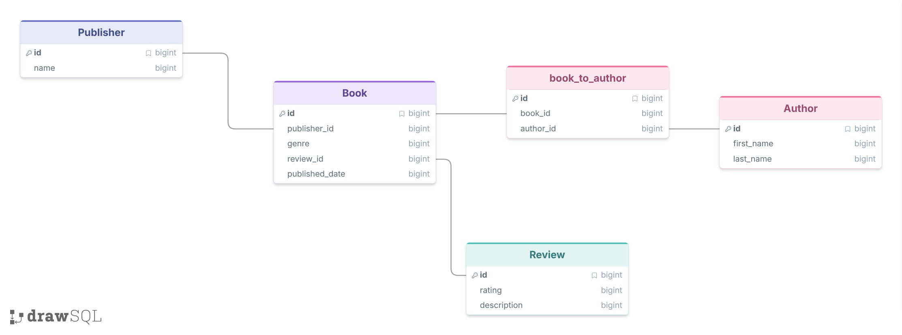

# Natural-Language Books Database

A simple books database with books, authors, reviews, and publishers.

## Schema



Five tables: `Publisher`, `Book`, `book_to_author` (join table), `Author`, and `Review`. A book has one publisher and one review, and can have many authors.

## Running it

```
pip install openai
python db_bot.py                # zero_shot prompting (default)
python db_bot.py few_shot       # adds two example question/SQL pairs to the prompt
```

Add your key to `config.json` first:

```json
{ "openaiKey": "your-key-here" }
```

Press Enter on an empty line to quit.

## Results

Full examples with SQL and responses are in [`examples.md`](examples.md).

**Worked:** "What is the oldest book?" returned *Pride and Prejudice* (1813) with correct SQL.

```sql
SELECT * FROM Book ORDER BY published_date ASC LIMIT 1;
```

**Did not work:** "How many books are by Robert Jordan?" returned 0. The SQL was correct, but the data stores the author as "Jordon," so the match fails. The model can't see the data, so it can't catch this.

```sql
SELECT COUNT(*) FROM Book b
JOIN book_to_author ba ON b.id = ba.book_id
JOIN Author a ON ba.author_id = a.id
WHERE a.first_name = 'Robert' AND a.last_name = 'Jordan';
```

Other failures in the logs: guessing a genre value that doesn't exist ("Fiction"), returning a publisher ID instead of a name, and a placeholder (`?`) with no parameters passed.

## Prompting strategies

- **zero_shot**: the system prompt contains only the schema and the rule "return one SELECT, no prose." This is the strategy used for every entry in `responses_zero_shot.json` and the main entries in `responses.json`.
- **few_shot**: the same prompt plus two example question/SQL pairs (`python db_bot.py few_shot`). Its runs are in `responses_few_shot.json`. Two entries in `responses.json` have "few_shot" typed into the question text. Those were run as zero_shot, so they are not part of the comparison.

**What Claude noticed:** both strategies handled the simple questions the same way: oldest book, most popular genre, and highest rated book. They also both failed on the same data-dependent questions: the "Jordon" typo and the nonexistent "Fiction" genre.

**What I noticed:** Because the model doesn't see the data it has a much harder time with the prompts. The paper talks about this, but I was curious how well it could shoot in the dark. Honestly shocked it did as well as it does. 

Where they differed:
- **few_shot was better** on "most popular publisher." It joined `Publisher` and returned a name. zero_shot returned an ID.
- **few_shot was worse** on "author's favorite genre." It copied the example's placeholder names (`AuthorFirstName`, `AuthorLastName`) into the query and answered "not available." zero_shot returned a confident but unfiltered answer ("Fantasy").
## Notes and limits

- The SQL is generated from the schema alone. The model does not see the data, so it can't know spellings or the exact values in a column. This means that user error / typos can't be fixed. 
